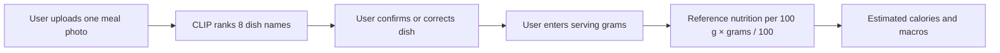
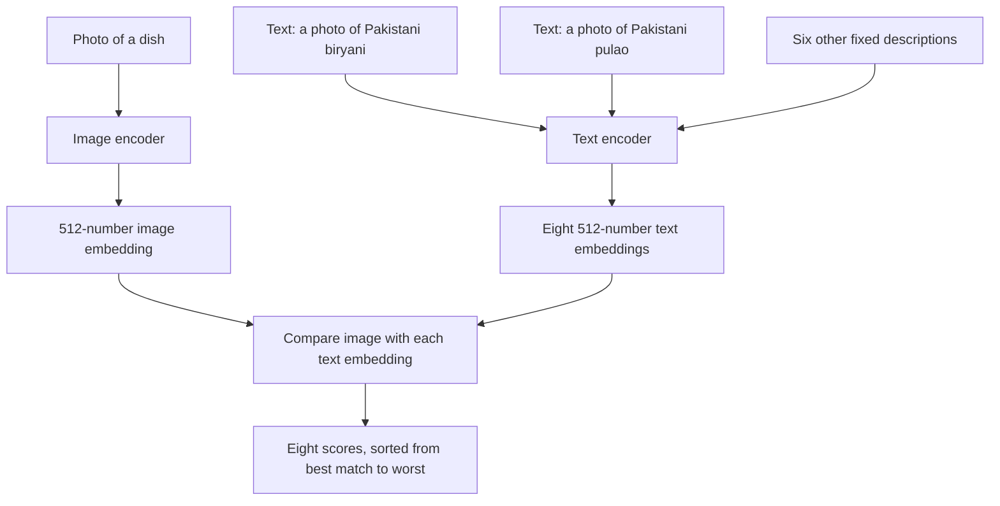
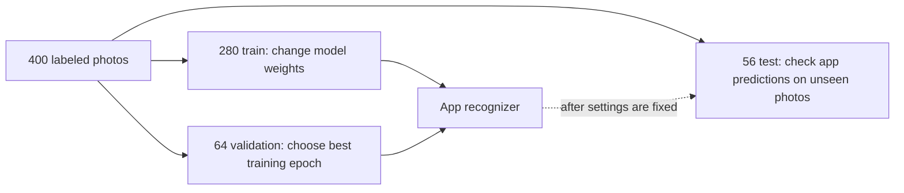
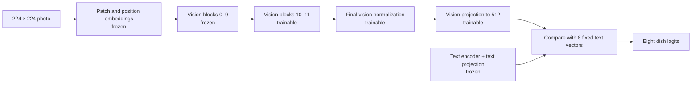
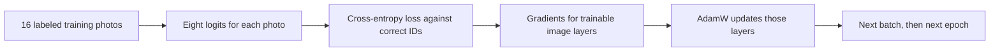

# Macromate Phase 3: a guided explanation of the model we will build

This is a teaching guide and implementation plan. It explains the ideas before naming the files and settings. No model code has been written yet. We will build one dish recognizer for the app, then connect it to photo upload, dish confirmation, serving weight, and nutrition lookup. Reserved test photos will check how the finished recognizer behaves on unseen images.

## 1. What problem are we solving?

The app will accept a photograph containing **one main dish** and suggest which of our eight known dishes it shows: chicken biryani, chicken pulao, chicken karahi, daal, nihari, haleem, samosa, or chapati. The user will confirm or correct that suggestion and enter the serving weight in grams. The app will then look up the confirmed dish's nutrition values per 100 g and multiply them by the entered weight. For example, a 200 g serving uses twice the stored per-100-g values. The model identifies the dish; it does **not** see the weight, count ingredients, measure calories from pixels, or diagnose health conditions.

This narrow scope matters. A mixed plate can contain several foods, whereas our training images have one label each. When the app eventually receives a mixed or unfamiliar meal, it should invite correction rather than pretending the top suggestion is certain.

## 2. What is a model, and what is CLIP?

A machine learning **model** is a large collection of numerical settings called *parameters* or *weights*. During training, a computer adjusts those settings so that useful patterns in input data lead to useful outputs. A conventional food classifier might directly convert a photo to eight class scores. CLIP takes a different route: it was pretrained to place **images and text descriptions in the same numerical space**. Images that fit a description should land close to that description in this space.

CLIP stands for *Contrastive Language–Image Pre-training*. It has two main parts, called **encoders**:

- The image encoder turns a photograph into a list of numbers, called an image **embedding**.
- The text encoder turns a sentence such as “a photo of Pakistani nihari” into a text embedding of the same length.

An embedding is not a readable description. Think of it as a point on a very detailed map: similar image and text meanings should be nearby. CLIP compares the points and gives each image/text pair a **similarity score**. Higher means a better match according to CLIP. It does not mean the dish is present with that percentage of certainty.

Our starting checkpoint is [OpenAI CLIP ViT-B/32 on Hugging Face](https://huggingface.co/openai/clip-vit-base-patch32). A **checkpoint** is saved pretrained weights. “ViT” means *Vision Transformer*: the image encoder divides a 224 × 224 image into 32 × 32 pixel patches and processes those patches together. “B/32” names this base-sized architecture and patch size. The official [checkpoint configuration](https://huggingface.co/openai/clip-vit-base-patch32/blob/main/config.json) specifies 12 image-transformer blocks (width 768, 12 attention heads), 12 text-transformer blocks (width 512, 8 attention heads), and projections into a shared 512-dimensional space. We use these existing layers rather than inventing a neural network from scratch.

### A few terms we will use

| Term | Plain-language meaning in this project |
| --- | --- |
| Label or class | One of the eight dish names that can be the correct answer. |
| Prompt | A sentence fed to CLIP's text encoder to represent a class. |
| Embedding | A numerical representation of an image or prompt. |
| Logit | A raw score for a class before converting scores to a ranked display. |
| Parameter / weight | A number inside the model that training can change. |
| Freeze | Prevent a parameter from changing during training. |
| Fine-tune | Start from pretrained weights and update some of them for our task. |
| Epoch | One pass through all training images. |
| Batch | A small group of images processed together. |
| Loss | A number measuring how wrong the model's scores are during training. |
| Optimizer | The rule for changing weights to reduce loss. |

## 3. Why use CLIP for this small dataset?

Our collection has 400 labeled photos, only 50 for each dish. Training a vision model from random weights would ask it to learn basic visual features and these eight dishes from very little data. CLIP already has broad image/text knowledge from pretraining. We will start from its pretrained checkpoint and adapt a small part of its image encoder to our dish labels. This is **transfer learning**: reuse general knowledge and learn task-specific adjustments.

The finished app will use **one fine-tuned CLIP recognizer**. Its starting weights come from the pretrained checkpoint; its saved weights after training are the model the app loads. The implementation work is to turn that single model into a reliable photo-to-dish component.

## 4. The photos we have and the meaning of the split

Phase 2 produced 400 prepared images and a fixed, group-aware split. There are 35 training, 8 validation, and 7 test photos per dish. In total that is **280 train, 64 validation, and 56 test**. Related photos are kept together so the app's accuracy check does not reuse nearly identical training photos.

Think of training as practice questions, validation as a small practice exam used to decide when to stop, and test as the final sealed exam. We will check the reserved photos after training to see where the app's suggestions are right or wrong. Only seven test photos per class are available, so this check cannot guarantee performance on new meals; user correction remains essential.

The file `data/processed/split.csv` says which subset each `image_id` belongs to. `clip_manifest.csv` connects that ID to a prepared image and label. `label_map.json` fixes the meaning of numbers 0–7: biryani 0, pulao 1, karahi 2, daal 3, nihari 4, haleem 5, samosa 6, chapati 7. The code will join files by `image_id`, check for duplicates or disagreements, and stop with a useful error if an image is missing. We must not rely on row order being the same in two CSV files.

## 5. Exactly how one photo becomes eight scores

### Step A: prepare the image

Phase 2 has already rotated images according to their camera metadata, converted them to RGB, resized and center cropped them to 224 × 224, and saved them as PNGs under `data/processed/clip_224/`. The model loader will read those PNG pixels, convert values from 0–255 to 0–1, then adjust each red, green, and blue channel using the **fixed CLIP mean and standard deviation**. The means are approximately `(0.4815, 0.4578, 0.4082)` and standard deviations `(0.2686, 0.2613, 0.2758)`. These are values expected by the pretrained model, not values recalculated from our 400 images.

It is crucial to normalize **once**. Feeding the saved PNGs through an image processor that resizes, crops, and normalizes again could change or double-normalize them. During training, validation, and later app inference, the same preparation must be used.

### Step B: prepare the dish descriptions

We will write one fixed English prompt for each label, in label-ID order: “a photo of Pakistani chicken biryani”, “a photo of Pakistani chicken pulao”, and the same sentence pattern for the other six dishes. The checkpoint's own tokenizer converts each sentence into tokens the text encoder understands. Text embeddings are computed once and kept fixed. The exact prompts will be saved with each run: changing “daal” to “lentil curry”, for example, could change scores even if the photo stays the same.

### Step C: compare them

The image encoder and its projection produce a 512-number image embedding. We normalize that vector and each text vector to length one. Their dot product is then **cosine similarity**: a measure of alignment, not a probability. CLIP's existing learned scale turns the similarities into eight logits. We keep this scale frozen while adapting the image encoder. The highest score becomes the top suggestion; the next two can be shown as alternatives.

For illustration only, suppose an image produces logits ordered as biryani 5.1, pulao 4.8, karahi 1.2, and lower scores for the others. The app would suggest biryani and offer pulao as a plausible alternative. Those example numbers are invented to explain ranking; they are **not measured model results**. A softmax can make eight displayed values add to 100%, but the values are not trustworthy real-world confidence without separate calibration.

## 6. What exactly changes during fine-tuning?

The checkpoint contains image and text transformers. Each transformer has successive **blocks** that progressively turn its input into a useful representation. In the first adaptation, we will update only the later image blocks and their final conversion to the shared embedding space. Earlier image blocks and all text components stay frozen. This limits the number of settings learned from only 280 photos and keeps our class descriptions stable.

“Attention heads” are parts of a transformer block that can relate different image patches or text tokens. We will not add, remove, or redesign them. There will be **no separate eight-output classifier layer**: the original CLIP image/text comparison is the recognizer's final scoring step and uses our fixed dish prompts.

Before training, code will list every trainable parameter group and count its parameters. After a small training step, a focused test will confirm the frozen layers did not change and the intended layers did. The text encoder will stay in evaluation mode while its fixed text embeddings are cached.

## 7. How does the model learn from a labeled batch?

Each training image has one correct label ID. A **batch** of 16 images passes through the trainable image pathway and gets eight logits per image. The **cross-entropy loss** measures whether the correct label received a higher logit than the seven alternatives. Lower loss means the model's scores fit those training labels better. Because all eight classes currently have equal numbers of images, we will not weight classes differently or smooth labels.

The **optimizer** is AdamW. It uses gradients, which indicate how changing a weight would affect the loss, to make small weight updates. We set different **learning rates** for different parts: `0.00001` for vision blocks 10–11 and `0.00005` for the final vision normalization/projection. The latter can adapt more quickly; both rates are intentionally small because we start from useful pretrained weights. Weight decay `0.01` discourages unnecessarily large weights, with biases and normalization weights exempt. AdamW's beta settings are `(0.9, 0.999)` and epsilon is `0.00000001`.

The rate starts with a short **warmup** over the first 10% of optimizer steps, then decreases smoothly with a **cosine schedule** to 10% of each starting rate. Warmup avoids an abrupt first update. We cap training at 20 epochs and clip the total gradient norm at `1.0` to reduce unusually large updates. The planned batch size is 16 for training and 32 for validation. These are starting settings for the app recognizer, not claims that they are optimal.

On a GPU, optional mixed precision may speed training and reduce memory usage. On a CPU, use full precision. The run record must say which device and precision were used. We will seed Python, NumPy, and PyTorch with `42`; matching runs on one machine should be close, although some hardware operations can still differ.

## 8. Validation, choosing a checkpoint, and avoiding overfitting

After each epoch, the model scores the 64 validation photos **without changing weights**. We record average loss, **top-1 accuracy** (correct dish ranked first), **top-3 accuracy** (correct dish anywhere in the first three), and correct/total counts for each dish. With only eight validation photos per dish, one mistake changes a dish's accuracy by 12.5 percentage points. Counts are therefore more informative than percentages alone.

We save the checkpoint with the highest validation top-1 accuracy. If epochs tie, lower validation loss wins; if still tied, the earlier epoch wins. Training stops after five consecutive epochs without improvement, or after 20 epochs. A **checkpoint** here includes the selected adapted weights plus the information needed to understand and reload them: prompt strings, label order, source checkpoint revision, preprocessing settings, split and manifest hashes, hyperparameters, software versions, device, chosen epoch, and validation results. Save it in an ignored `runs/` directory so large binary weights do not enter Git by accident; preserve a small textual summary for the report.

**Overfitting** means becoming good at the small practice set while failing on new photos. Training loss may keep falling while validation loss rises. Early stopping and partial freezing limit this risk, but cannot prove generalization. Our images also have source-specific styles: some dishes come from only one provider. A model may learn backgrounds or resizing artifacts associated with a source. The final held-out and future external-photo checks must discuss this limitation.

## 9. Which libraries and files will we create?

Use **Python**, **PyTorch** (`torch`) for tensors, gradients, data loading and optimization, and **Hugging Face Transformers** (`transformers`) for the pretrained `CLIPModel` and matching tokenizer. Use the existing **Pillow** for PNG reads and **NumPy** for reproducibility or summary calculations. Standard-library modules handle CSV, JSON, paths, hashes and logs. A Phase 3 dependency file will pin versions actually tested on the training machine; PyTorch's CPU/CUDA installation depends on that machine. Official references are the [Transformers CLIP documentation](https://huggingface.co/docs/transformers/model_doc/clip), [PyTorch cross-entropy](https://docs.pytorch.org/docs/stable/generated/torch.nn.CrossEntropyLoss.html), and [PyTorch AdamW](https://docs.pytorch.org/docs/stable/generated/torch.optim.AdamW).

| Planned file | What it will do, in everyday terms |
| --- | --- |
| `requirements-model.txt` | Record the additional tested model-library versions. |
| `model/config.py` | Keep the checkpoint identity, prompts, label order, learning settings and paths in one place. |
| `model/data.py` | Check the manifests, load prepared photos and make training/validation batches. |
| `model/clip_classifier.py` | Load CLIP, create fixed dish text vectors, freeze the selected layers and return eight scores. |
| `model/train.py` | Run training epochs, validation, early stopping and best-checkpoint saving. |
| `model/infer.py` | Reload the adapted recognizer and rank dishes for a new photo. |
| `model/metrics.py` | Count correct predictions and calculate losses and validation metrics. |
| `model/evaluate.py` | Check app prediction quality on reserved photos and identify dishes the model often confuses. |
| `model/nutrition.py` | Look up the user's confirmed dish and scale its per-100-g nutrition values by serving weight. |
| `app/` | Provide photo upload, suggestion review and correction, gram entry, and nutrition display. Select its UI framework when app requirements are supplied. |
| `tests/test_model_contracts.py` | Catch changed label order, bad manifests, repeated normalization, wrong score shape, incorrect freezing or incomplete checkpoint data. |
| `runs/` | Hold generated model weights and epoch histories outside Git. |

The code will be modular because these responsibilities have different failure modes. For example, a wrong label join is a data error, while a frozen layer updating is a training error. Small focused tests can identify each one. The exact download revision and working library versions will be locked when implementation starts, then recorded with every run.

## 10. What will happen in implementation order?

1. Lock a compatible PyTorch/Transformers environment and the exact CLIP checkpoint revision. Confirm the machine has enough memory to load the checkpoint.
2. Implement and test the data loader against the existing 400-image manifests. Verify the intended 280/64/56 membership and eight label IDs; keep test out of training and validation loaders.
3. Load the pretrained weights into our recognizer, then verify that its image and prompt inputs produce eight correctly ordered scores.
4. Implement partial freezing, the loss and optimizer, a one-batch update check, then the full training/validation loop.
5. Save and reload the best checkpoint. Its validation predictions should match before and after reload in the same environment. Record the run settings and history.
6. Check app prediction quality on reserved photos with top-1, top-3, and per-dish correct/total counts. Record common mistakes so the interface can make correction easy.
7. Implement the app flow: upload a photo, suggest a dish, let the user confirm or correct it, accept a positive serving weight in grams, and show the nutrition estimate. Check that the confirmed dish drives the calculation.

The model part is complete when one adapted checkpoint returns eight ordered dish scores, trains only on the designated 280 photos, is selected using the 64 validation photos, and reloads with its data and settings. The app part is complete when a user can upload one meal photo, confirm or change the dish, enter grams, and receive a clearly labeled nutrition estimate. We will check the finished flow end to end before calling it ready.

## 11. Questions a new team member might ask

**Will CLIP tell us the grams or calories from the photo?** No. Dish recognition and nutrition multiplication are separate. The user supplies grams; nutrition comes from `data/nutrition.csv` after confirmation.

**Why write prompts if we have labels?** CLIP compares a photo with text. Prompts turn our labels into the text inputs it needs. Their wording is saved with the app model so dish meanings stay consistent.

**Why freeze most layers?** We have only 280 training examples. Updating every CLIP weight could let the model memorize those images and lose useful pretrained knowledge. Freezing is a cautious initial choice, which validation can test.

**Is a top score of 70% a 70% chance the dish is correct?** No. Softmax scores depend on the eight offered classes and can be high even when none fits. The app should allow correction and not present raw scores as reliable confidence.

**Why not use test images now?** Test data estimates how a finished decision works on unseen examples. Looking at it while choosing prompts, settings, or checkpoints would bias that estimate.
