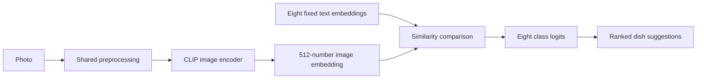

# Phase 3: understanding our model implementation

This document explains what we built, how the code works, and how to read its
outputs. Read it alongside the Python files in `model/`. The numerical results
come from the saved records in `evidence/phase3/`, not from a new training run.

The main outcome was a working **eight-dish CLIP recognition engine**, a trainer,
an inference interface, and a small measured experiment for selecting settings.
Full training and final test evaluation belong to Phase 4.

## 1. What Phase 3 was

### From prepared images to a model engine

Phase 2 gave us images, labels, prepared PNG files, and a fixed data split.
Phase 3 had to turn these into Python code that could:

1. Read the prepared data correctly.
2. Load a pretrained model and produce eight dish scores.
3. Update only the layers we intended to train.
4. Measure training and validation performance.
5. Save and reload adapted weights.
6. Suggest a dish for a new photograph.
7. Compare a small set of training settings and record the actual outcomes.

The three main academic requirements were **framework selection**, **model
design**, and a **hyperparameter tuning record**. Writing candidate values in a
plan would satisfy only part of this: we also needed measured pilot results.

### The recognition task

Each photograph has one correct class from this fixed order:

```text
0  chicken biryani
1  chicken pulao
2  chicken karahi
3  daal
4  nihari
5  haleem
6  samosa
7  chapati
```

The order comes from `data/processed/label_map.json`. If output position 3 means
daal during training, it must also mean daal during inference. A good numerical
prediction would become the wrong dish name if these orders were mixed up.

The model suggests dish identity. Serving weight and nutrition calculations
remain separate: a later application will ask the user to confirm the dish and
enter grams, then use the nutrition reference values.

### The libraries we selected

- **PyTorch:** tensors, gradients, datasets, batches, optimization, GPU execution
  and checkpoint files. A tensor is an array of numbers that PyTorch can process
  and differentiate.
- **Hugging Face Transformers:** the pretrained `CLIPModel` and matching
  `CLIPTokenizerFast`.
- **Pillow:** opening images, handling orientation, resizing and cropping.
- **NumPy:** converting image pixels to numerical arrays and supporting seeding.
- **Python standard library:** CSV, JSON, paths, hashes, command-line arguments,
  timing and experiment records.

`requirements-model.txt` records the tested direct dependencies: PyTorch 2.9.0,
Transformers 4.57.1, NumPy 2.2.6 and Pillow 11.3.0. The successful runs used
Python 3.12.10, the `2.9.0+cu128` PyTorch build, and an NVIDIA GeForce RTX 3050
Laptop GPU with approximately 4 GB VRAM. `cu128` identifies the CUDA 12.8 build.
The recorded numerical precision was `float32`.

## 2. What our plan was

The original requirements are in `docs/02_Implementation_plan_phase_3.md`.
We followed this sequence:

1. **Lock the framework and starting model.** Use pretrained CLIP ViT-B/32 and
   pin its exact revision so experiments start from the same weights.
2. **Protect the data contract.** Check IDs, labels, paths, groups and split
   counts before creating training batches.
3. **Define one recognizer.** Compare image embeddings with eight fixed dish
   descriptions. Keep most pretrained parameters frozen.
4. **Implement training.** Use cross-entropy, AdamW, separate learning rates,
   a schedule, clipping, validation and checkpoint selection.
5. **Implement independent inference.** Load saved adapted weights and rank
   dishes without starting the training code.
6. **Check correctness.** Verify preprocessing, layer freezing, weight updates,
   output shape, metadata and checkpoint reload behavior.
7. **Run a controlled pilot.** Try six configurations with the same seed,
   starting checkpoint, split and two-epoch budget.
8. **Preserve evidence and hand off to Phase 4.** Save the selected configuration,
   histories, predictions and explanations of the results.

We chose small Python modules with ordinary functions and explicit loops. This
lets the same preprocessing and model serve both training and future application
inference, without adding a general training framework.

### How the data split supports the plan

The collection has 400 images, 50 per dish:

- **280 training images:** 35 per dish; these produce gradients and weight updates.
- **64 validation images:** eight per dish; these guide epoch and setting selection.
- **56 test images:** seven per dish; these remain reserved for Phase 4.

Validation data influenced our choices, so validation accuracy is an exploratory
result. Final test evaluation must use the separate reserved photos.

The manifest checks read membership information for all three subsets and check
that their files exist. Phase 3 training and validation loaders do not decode
test images, and the data-lineage helper hashes train/validation image contents
only. Reading split metadata is different from evaluating test-photo predictions.

## 3. How we implemented Phase 3 at a high level

### 3.1 Start with an existing image-and-text model

CLIP has an image encoder and a text encoder. An **encoder** turns its input
into a numerical representation called an **embedding**. Our checkpoint maps
both images and text into the same 512-dimensional space: each embedding is a
list of 512 numbers.

We loaded `openai/clip-vit-base-patch32` at revision:

```text
3d74acf9a28c67741b2f4f2ea7635f0aaf6f0268
```

Pinning a revision fixes the source model version. Loading a moving `main`
revision in every experiment could silently change the starting point.

The existing image tower is a Vision Transformer with 12 blocks, hidden width
768 and 12 attention heads. It divides a 224-by-224 image into 32-by-32 patches:
seven patches per side, or 49 image patches. Its pooled output is projected into
512 dimensions. The text tower has 12 blocks, hidden width 512 and eight heads.
These layers came from the pretrained checkpoint; we did not implement a
transformer from scratch.

### 3.2 Create eight fixed text descriptions

For every dish, we use the same prompt pattern:

```text
a photo of Pakistani chicken biryani
a photo of Pakistani chicken pulao
...
a photo of Pakistani chapati
```

The tokenizer converts these sentences to token IDs understood by CLIP's text
encoder. These token IDs are different from our eight dish class IDs.

We encode the prompts once and keep their normalized embeddings fixed. During
fine-tuning, the image representation learns to match the appropriate fixed
description more closely.

### 3.3 Turn one image into eight logits

The prediction path is:



For a batch of eight images, the important shapes are:

```text
Image tensors:          [8, 3, 224, 224]
Image embeddings:       [8, 512]
Fixed text embeddings:  [8, 512]
Output logits:          [8, 8]
```

In the last shape, the first 8 is the number of images; the second is the number
of candidate dishes. Each image receives one score for every class.

The central calculation in `DishClassifier.forward()` is:

```python
pooled = self.clip.vision_model(pixel_values=pixels).pooler_output
image_features = F.normalize(self.clip.visual_projection(pooled), dim=-1)
return self.clip.logit_scale.exp() * image_features @ self.text_features.T
```

Read this as: encode the image, project it, normalize its embedding, and compare
it with each text embedding. `@` means matrix multiplication; `.T` transposes
the text matrix so the comparison produces one column per dish.

Normalizing embeddings to unit length makes their dot product a cosine
similarity. CLIP's existing positive scale multiplies those similarities to
produce **logits**, the raw scores used by the loss function. The largest logit
determines the first suggested dish.

Embedding normalization here is separate from the pixel normalization below.
Both are intentional operations on different kinds of numbers.

### 3.4 Train only a small part of CLIP

A parameter marked `requires_grad = False` is frozen: the optimizer does not
update it. We first freeze everything, then enable training for:

- Vision transformer blocks **10 and 11**.
- The final vision layer normalization.
- The visual projection into the shared embedding space.

Blocks use zero-based numbering, so 10 and 11 are the last two of the 12 blocks.
Patch/position embedding parameters, the initial vision normalization, vision
blocks 0 through 9, the text tower, text projection and logit scale remain frozen.
The actual trainable count is **14,570,496 numerical
parameters**; the names and individual sizes are recorded in each `setup.json`.

This is **partial fine-tuning**: adapt selected existing weights while retaining
most pretrained features. That is a cautious choice for only 280 training photos.
We retained CLIP's visual projection and similarity calculation; we did not add
a separate eight-class linear head.

### 3.5 Teach the model using the known class

For an image labeled daal, the target is class ID 3. We pass the eight raw logits
and that integer target into:

```python
loss_function = nn.CrossEntropyLoss()
loss = loss_function(logits, labels)
```

Cross-entropy penalizes the model when it assigns too little relative score to
the correct dish. It handles the necessary log-softmax calculation internally,
so training supplies raw logits. The initial objective uses no class weights
and no label smoothing; the current dataset is balanced.

`loss.backward()` calculates gradients: directions in which changing parameters
would change the loss. AdamW uses them to update the trainable parameters.
Our supervised objective chooses among eight fixed descriptions; we are not
repeating CLIP's original large-scale pretraining procedure.

## 4. Implementation method: file-level explanations

### 4.1 `model/config.py`: the shared settings

This file holds paths, checkpoint name/revision, image size, CLIP channel means
and standard deviations, and the initial training defaults.

Important functions are:

- `read_labels()`: read and validate the eight class names in ID order. It checks
  that the two directions of the label map agree.
- `prompts_for(labels)`: make one consistently worded prompt per dish.
- `preprocessing()`: describe the transformation contract saved with checkpoints.
- `sha256(path)`: calculate a file fingerprint for data lineage.
- `write_json(path, value)`: save readable JSON and reject nonfinite JSON values.

**Teaching point:** `DEFAULTS` describes starting settings. The pilot-selected
settings live separately in `evidence/phase3/selected_config.json`. In particular,
the default block learning rate is `1e-5`; the selected value is `2e-5`.

### 4.2 `model/contracts.py`: validate the records before reading pixels

`read_unique()` reads CSV rows into a dictionary keyed by `image_id`. Empty or
duplicate IDs raise an error.

`load_records()` joins `clip_manifest.csv` and `split.csv` using that ID. It checks
that both files describe the same images and agree on labels and label IDs.
It also checks known split names, group separation, unique existing image paths,
and the expected 35/8/7 images per class across train/validation/test.

A **group** identifies records that must stay together. If the same group occurs
in both training and validation, related images could make validation appear
easier than it really is. The function rejects that situation.

`data_lineage()` records hashes of the manifests, label map and train/validation
image contents. A hash is a fingerprint, not a copy of the image. Reload
verification can detect changed data even if the filenames stayed the same.

This file uses only the standard library, allowing record checks independently
of the model runtime.

### 4.3 `model/data.py`: convert images to batches

`image_tensor()` has two input routes:

1. **Prepared Phase 2 image:** require an RGB, 224-by-224 PNG. Keep its existing
   geometry, divide pixels by 255, and apply CLIP channel normalization once.
2. **Original/uploaded image:** correct EXIF orientation, convert to RGB, resize
   the shorter side to 224 with bicubic interpolation, centre-crop, then apply
   the same pixel scaling and normalization.

The upload recipe matches `data scripts/preprocess.py`, including resize
rounding. Training and future uploads therefore receive compatible inputs.

For each channel, the pixel calculation is:

```python
normalized_value = (pixel_value / 255.0 - channel_mean) / channel_std
```

The CLIP means are `(0.48145466, 0.4578275, 0.40821073)` and standard deviations
are `(0.26862954, 0.26130258, 0.27577711)` for red, green and blue. These constants
come from the pretrained model's input convention; we do not estimate them from
our 400 photos. Phase 2 saved ordinary RGB PNGs, so this normalization still needs
to happen when loading them.

`DishDataset` returns `(image_tensor, integer_label, image_id)` for one sample.
It accepts only `train` or `val`; requesting a test dataset raises an error.
`make_loaders()` groups samples into batches, shuffles training with a seeded
generator, and keeps validation order stable. It uses `num_workers=0` for a
simple loading setup.

### 4.4 `model/clip_classifier.py`: define the recognizer

`load_pretrained()` loads the pinned CLIP checkpoint from `runs/hub/`. It uses
`local_files_only=True`, so the base model and tokenizer must already be cached.
It encodes prompts unless saved text features were supplied during reload.

`DishClassifier` wraps CLIP and stores the eight fixed text embeddings as a
**buffer**. A buffer moves with the model between CPU and GPU, but is not a
trainable parameter.

`freeze_layers()` implements the freeze policy. It checks the expected module
structure and the presence of 12 vision blocks before enabling selected layers.
`forward()` performs the embedding comparisons explained above.
`trainable_inventory()` returns trainable parameter names and sizes for logging.

**Teaching point:** the wrapper controls which existing layers learn and how
scores are calculated. It does not create a new transformer architecture.

### 4.5 `model/metrics.py`: measure the predictions

`summarize()` calculates average cross-entropy, top-1 correct counts, top-3
correct counts, accuracies, and correct/total counts per class. It checks that
the logits are finite.

- **Top-1:** was the first suggested dish correct?
- **Top-3:** did the correct dish appear anywhere in the first three suggestions?
- **Loss:** how well did the relative scores support the correct labels?

`selection_key()` returns `(top1_correct, -loss)`. Python compares tuples from
left to right, so a higher correct count wins first; a lower loss breaks a tie.
Top-3 is recorded but does not determine the chosen epoch or candidate.

Precision, recall, F1, confusion matrices and ROC-AUC are not implemented here
yet; those are Phase 4 evaluation tasks.

### 4.6 `model/train.py`: run learning and validation

`seed_everything()` seeds Python, NumPy and PyTorch with 42 and enables
deterministic algorithms. `environment()` records software, device, CUDA,
precision, GPU memory and CPU thread settings. Reproducibility still depends on
the environment; a seed alone does not promise identical results on every GPU
or library version.

`make_optimizer()` builds AdamW groups using only trainable parameters. There
are two learning-rate families: vision blocks and final norm/projection. Each
family separates weights that receive decay from biases/normalization weights
that receive zero decay. AdamW uses betas `(0.9, 0.999)` and epsilon `1e-8`.

A **learning rate** controls the scale of an update. **Weight decay** applies
regularization to selected weights. The chosen block rate `2e-5` means `0.00002`;
the chosen norm/projection rate `5e-5` means `0.00005`.

`make_scheduler()` starts with a 10% step warmup, then decreases rates along a
cosine curve. Configuration values are the base rates: actual per-step rates
change during the run. With batch 8, 280 training images require 35 updates per
epoch. Two epochs mean 70 updates, with seven warmup steps.

`run_epoch()` has two modes:

1. **Training:** enable gradients, clear old gradients, calculate logits/loss,
   backpropagate, clip global gradient norm at 1.0, update weights, and advance
   the scheduler.
2. **Validation:** use evaluation mode, disable gradient calculation, collect
   predictions and calculate metrics without changing weights.

Both modes reject nonfinite logits or loss. Clipping rejects a nonfinite
gradient norm as well. These checks prevent a numerically broken run from
quietly producing apparently usable results.

`train_run()` coordinates epochs, histories, best-checkpoint saves, early
stopping and reload checks. An epoch is one pass through the subset. A new
checkpoint wins by top-1 correct count, then loss. An exact tie keeps the earlier
checkpoint. Five validation epochs without improvement trigger early stopping.
The two-epoch pilot was too short to exercise that five-epoch stopping rule.

Training metrics are collected while weights change across batches. They are
not a separate evaluation of the final epoch weights on the entire training set.

### 4.7 `model/checkpoint.py`: save enough information to reconstruct the model

`save_checkpoint()` stores the adapted trainable weights and fixed text features,
plus class names, prompts, preprocessing, base revision, trainable inventory,
settings, data lineage, environment, chosen epoch and validation metrics.
It writes a temporary file before replacing the checkpoint path.

`read_checkpoint()` loads tensors and metadata with `weights_only=True` and checks
the checkpoint contract. `apply_checkpoint()` checks parameter names, shapes and
finite values before copying the adapted tensors into a model.

`load_checkpoint()` reconstructs the pinned pretrained base, applies the saved
adaptation, and switches to evaluation mode. The full base checkpoint must still
be available in the cache: `best.pt` contains our adaptation, not another complete
copy of every CLIP weight.

The checkpoint does not contain optimizer/scheduler state for exact mid-run
training resumption. Its purpose here is prediction, verification and preserving
the selected adapted model.

### 4.8 `model/infer.py`: use the model for a photograph

`Recognizer(checkpoint, device)` loads a saved model. Calling
`predict(photo, prepared=False)` uses the upload preprocessing route and returns
all eight dishes in ranked order. Use `prepared=True` only for Phase 2 PNGs.

The code runs inside `torch.inference_mode()`, with no training updates. It
calculates softmax scores for the returned ranking and explicitly marks them
as uncalibrated. Importing this interface does not import `model.train`.

This is the interface a future application can call after loading its chosen
checkpoint once. The command-line entry point also lets us test it independently.

### 4.9 `model/pilot.py`: compare six declared configurations

Every candidate starts again from the same pretrained checkpoint, with seed 42,
the same prompts and split, and two full epochs. Only the named setting changes
from the default:

1. `baseline`: block LR `1e-5`, norm/projection LR `5e-5`, batch 8, decay `0.01`.
2. `block_low`: lower block LR to `5e-6`.
3. `block_high`: raise block LR to `2e-5`.
4. `projection_low`: lower norm/projection LR to `2e-5`.
5. `batch_16`: raise batch size to 16.
6. `no_decay`: set weight decay to zero.

The baseline is the default **fine-tuning candidate**, not a separate zero-shot
evaluation. These are six independent two-epoch runs, not twelve successive
epochs on one model. Dropout stays zero throughout.

The pilot holds photo exposure and epochs equal. Batch 16 has 18 training batches
per epoch, including a final smaller batch, so it performs fewer optimizer steps
than batch 8. This is a limitation of an equal-epoch comparison.

Across candidates, the script selects by highest validation correct count, then
lower loss, then lower measured runtime for an exact metric tie. It exports the
selected settings with `epochs=20` for the Phase 4 cap. This field does not mean
the pilot ran for 20 epochs.

Existing completed runs can be reused after protocol/data/settings checks.
Nonempty unfinished run folders are not overwritten. Attempted failures are
recorded separately, and the script refuses to claim that all candidates
completed if any failed.

### 4.10 `model/verify.py`: check independent loading

This script starts through the inference interface, checks the current label
order and data fingerprints against the saved checkpoint, and predicts all 64
validation photos again in their original order and batch size.

It compares every logit with the saved predictions, using an absolute tolerance
of `1e-6` on the same device type and `1e-4` across CPU/CUDA. It also verifies one
sample's inference ranking and records whether training code was imported.

The actual CUDA check had maximum logit difference **0.0**, and
`training_module_imported` was `false`. A separate original-photo inference run
also succeeded, checking the upload route beyond prepared PNGs.

### 4.11 `model/report.py`: turn measured evidence into report text

This reads results, selection and verification files. It requires all pilot
candidates to have completed and independent verification to have passed before
exporting `report/phase3.tex` and `docs/05_Phase_3_results.md`.

The exporter copies measured values into the explanation and tuning record.
This reduces the risk of manually reporting candidate settings as tested results.
It assumes the `report/` output directory already exists; exporting a section and
compiling the complete report are separate operations.

### 4.12 `model/__init__.py`, dependencies and the original tests

`model/__init__.py` marks the folder as a Python package. This supports commands
such as `python -m model.pilot`: `-m` runs the module through Python's package
system, which allows the relative imports between model files to work.

`requirements-model.txt` pins the four direct model libraries. Supporting
packages such as tokenizers and the Hugging Face Hub are installed as dependencies;
their measured versions are recorded in the setup logs.

During implementation, two test files checked data contracts and model mechanics:
`tests/test_data_contracts.py` and `tests/test_model_contracts.py`. The recorded
total is **16 passing tests**. Checks included bad manifests, group leakage,
normalization, output shape, trainable parameter selection, updates to the
intended layers, unchanged validation weights, and checkpoint round trips.
Small randomly initialized CLIP fixtures tested mechanics; the six reported
pilot runs used the actual pretrained checkpoint.

Those test files are absent from the current workspace. The saved status records
their earlier successful execution; this teaching document does not claim to
have rerun missing tests.

## 5. Understanding the outputs

### 5.1 The console training messages

The selected candidate produced these messages, rounded for display:

```text
block_high epoch 1: train loss 0.4871; val 56/64, loss 0.2719
block_high epoch 2: train loss 0.0746; val 58/64, loss 0.2825
```

The first loss is measured on training batches; the second is validation loss.
The falling training loss shows the optimizer learned the training examples
under this objective. It does not by itself establish generalization.

Notice that epoch 2 has **more correct validation predictions but a slightly
higher validation loss**. We still selected epoch 2 because top-1 correct count
is the primary rule. Loss and correct-count accuracy measure different aspects
of the predictions; they do not have to improve together.

### 5.2 The measured tuning outcomes

`evidence/phase3/tuning.csv` records each run's settings, completed epochs, best
epoch, validation counts, loss and measured run duration. All six completed two
epochs. Their best-checkpoint outcomes were:

- `baseline`: 58/64 correct; loss `0.294529`; best epoch 2.
- `block_low`: 57/64 correct; loss `0.307729`; best epoch 2.
- `block_high`: 58/64 correct; loss `0.282456`; best epoch 2.
- `projection_low`: 57/64 correct; loss `0.302356`; best epoch 2.
- `batch_16`: 57/64 correct; loss `0.344546`; best epoch 1.
- `no_decay`: 58/64 correct; loss `0.294530`; best epoch 2.

`block_high` tied the best correct count and had the lowest loss among those
tied candidates. That is why it won, even though it did not increase the number
correct over the default candidate.

The default and no-decay losses were almost identical. This pilot does not prove
that decay `0.01` meaningfully improves generalization. We also did not test every
combination or interactions between parameters. The selected configuration is
supported by this small declared comparison, rather than established as globally
optimal.

### 5.3 The selected validation metrics

`evidence/phase3/selection.json` records:

- **Top-1:** `58 / 64 = 90.625%`.
- **Top-3:** `63 / 64 = 98.4375%`.
- **Average cross-entropy:** approximately `0.282456`.
- **Selected epoch:** 2 of the selected pilot.

Top-3 means the true dish appeared among three suggestions; it does not mean
the first suggestion was correct 98.4% of the time. These are validation results
after using validation to select settings, not final test results.

One validation image changes accuracy by `100 / 64 = 1.5625` percentage points.
Small differences therefore deserve cautious interpretation.

### 5.4 How to read the evidence directory

The files have different jobs:

- `protocol.json`: the declared candidate changes, fixed settings, epoch budget,
  labels, selection rule and data fingerprints.
- `results.json`: all candidate outcomes, including measured settings,
  environment, completed epochs, best epoch and reload checks.
- `tuning.csv`: a compact comparison of those outcomes.
- `selection.json`: the winning candidate, validation metrics and checkpoint path.
- `selected_config.json`: settings to use for the full Phase 4 training run.
- `verification.json`: fresh-process reload comparison, sample inference and the
  check that training code was not imported.
- `upload_prediction.json`: the standalone prediction for an original validation
  photograph through the upload route.
- `status.json`: the recorded completion/check summary, software environment,
  verified download hashes and report-build record.

Inside each candidate's evidence folder:

- `setup.json` records settings, environment and every trainable parameter name/size.
- `history.json` records each epoch's train/validation metrics, starting learning
  rates and duration.
- `best_validation_predictions.json` preserves image IDs, target labels and all
  eight raw logits per image for the selected epoch.

The full local run folder originally also held `best.pt` and `result.json`.
Small evidence files were kept separately so experiment results could be reviewed
without putting large weights in Git.

### 5.5 What a prediction means

The following is an excerpt from the original-photo prediction. Only its first
ranked entry is shown here; the actual interface returns all eight dishes:

```json
{
  "scores_are_calibrated": false,
  "score_description": "Softmax ranking over eight supported dishes",
  "ranked_dishes": [
    {
      "label_id": 7,
      "dish": "chapati",
      "logit": 32.63621139526367,
      "score": 0.9992238283157349
    }
  ]
}
```

`label_id` connects the answer to the fixed label map. `logit` is the raw
similarity-based score. `score` is softmax applied across our eight classes,
which gives positive values summing to one for the complete ranking.

The large chapati score describes how strongly this image favors chapati over
the other seven offered descriptions. It is not a calibrated 99.9% probability
that any uploaded meal is chapati. The system can also produce a strong score
for an unsupported food because it always ranks these eight choices.

### 5.6 What the checkpoint verification proved

`verification.json` reports `reload_max_error: 0.0` across all 64 validation
images. In that environment, independent reconstruction recovered the same
logits as the saved best epoch. This checks saving, loading, label ordering and
prediction consistency. It does not independently measure recognition quality;
the images were still the same validation set.

### 5.7 Current workspace versus recorded outputs

At the time this teaching guide was written, the model source and
`evidence/phase3/` were present, but `tests/`, `runs/`, `report/`, and the earlier
generated execution/results/status Markdown files were absent. Consequently:

- The recorded pilot checkpoint path `runs/phase3/block_high/best.pt` currently
  names a missing local artifact.
- The base cache and standalone interpreter formerly inside `runs/` also need
  restoration or a new permitted Python environment/model cache.
- The report-build and 16-test results in `status.json` are historical execution
  records, not a claim that those files currently exist.

The teaching guide leaves the current workspace structure intact. To reproduce
the original checks, restore their source files; to perform inference, restore
or regenerate the compatible weights and base cache. This also explains why
remaining JSON evidence can describe successful work while a binary checkpoint
is no longer available locally.

## 6. What is done and what remains for Phase 4

### 6.1 Completed in Phase 3

We selected and exercised the framework, implemented the eight-dish architecture,
defined its trainable layers/loss/optimizer, built data and inference interfaces,
ran the six measured pilots, selected a configuration, and verified independent
checkpoint loading. The implementation recorded 16 passing contract tests and
generated a technical report section and compiled report during that work.

The selected settings to carry forward are:

```json
{
  "block_lr": 0.00002,
  "projection_lr": 0.00005,
  "batch_size": 8,
  "weight_decay": 0.01,
  "epochs": 20,
  "patience": 5,
  "seed": 42,
  "warmup_fraction": 0.1,
  "gradient_clip": 1.0,
  "betas": [0.9, 0.999],
  "epsilon": 0.00000001,
  "dropout": 0.0
}
```

Learning rates, batch size and decay were explored by the pilot. Zero dropout,
fixed prompts, the 20-epoch cap and patience five were held as design choices;
the pilot did not demonstrate that they are optimal. Only two training epochs
were completed per candidate.

### 6.2 The remaining Phase 4 work

The detailed requirements are in `docs/03_Implementation_plan_phase_4.md`:

1. **Check the handoff and data lineage.** Confirm that labels, source revision,
   prompts, preprocessing and split still match the selected experiment. Restore
   the local runtime/cache and any required verification sources first.
2. **Perform full training.** Start from the pinned pretrained base with the
   selected settings, run up to 20 epochs, and apply patience-five early stopping.
   This is a fresh full run, not an instruction to append 18 epochs to a pilot.
3. **Select and reload the best full-training checkpoint.** Use validation
   correct count, then loss, and verify the saved predictions again.
4. **Implement the held-out evaluator.** Add `model/evaluate.py` and an explicitly
   controlled test-data loading route. The current `DishDataset` intentionally
   rejects `test`; leave that protection in place for pilot training.
5. **Lock and run the test protocol.** Record metric definitions before reading
   the 56 test predictions. Do not change prompts or settings in response to test
   mistakes and then treat that same test set as a fresh unbiased evaluation.
6. **Calculate the required metrics.** Top-1/top-3, per-class precision, recall,
   F1, macro/appropriate weighted averages, a confusion matrix, and multiclass
   one-vs-rest ROC-AUC. Add a tested `scikit-learn` dependency if using it for these.
7. **Explain errors and bias.** Inspect confused dishes and outcomes by source
   and available image characteristics, report group sizes, and write the Bias
   Check. Person demographics are unavailable; do not invent demographic results.
8. **Write the final results and app handoff.** Preserve the evaluated checkpoint,
   report limits and common errors, and ensure the future app loads that model.

Seven test images per dish will still give imprecise class-level estimates.
The pending second human label review, source/label entanglement, and limited
coverage of external Pakistani meal photos remain important limitations.

### 6.3 Commands and their prerequisites

These commands are reference instructions, not new runs performed while writing
this guide. Run them from the repository root in a Python environment with the
dependencies in `requirements-model.txt` and the pinned base model cached in
`runs/hub/`. See the README for the download command.

To regenerate the Phase 3 pilots and verification:

```powershell
python -m model.pilot --epochs 2 --device cuda
python -m model.verify --device cuda
```

To begin the Phase 4 full-training run:

```powershell
python -m model.train --config evidence/phase3/selected_config.json --epochs 20 --output runs/phase4 --device cuda
```

The output folder must be new or empty; the trainer refuses to overwrite a run.
Use `--device cpu` if the permitted PyTorch environment has no available CUDA GPU.

After full training produces its checkpoint, a single-photo command will be:

```powershell
python -m model.infer runs/phase4/best.pt path/to/photo.jpg --device cuda
```

`path/to/photo.jpg` is a placeholder for the actual uploaded image. In Python,
the application-facing call is:

```python
from model.infer import Recognizer

recognizer = Recognizer("runs/phase4/best.pt", device="cuda")
prediction = recognizer.predict("path/to/photo.jpg")
```

The upload screen, confirmation/correction flow, serving-gram entry, nutrition
calculation and daily log belong to later application work. Phase 4 establishes
the trained model's measured behavior before that integration.
