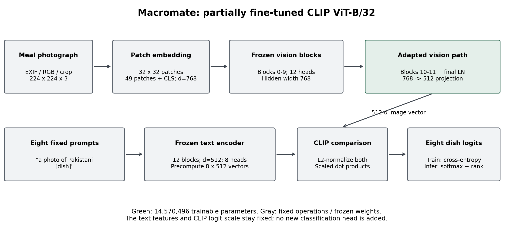
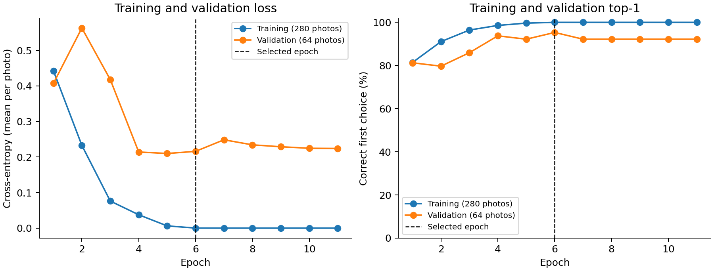
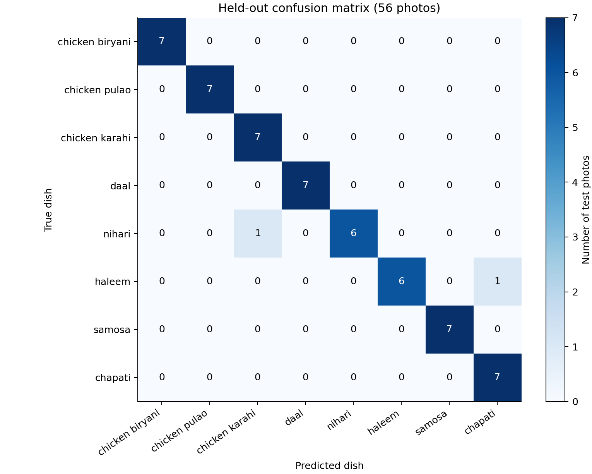
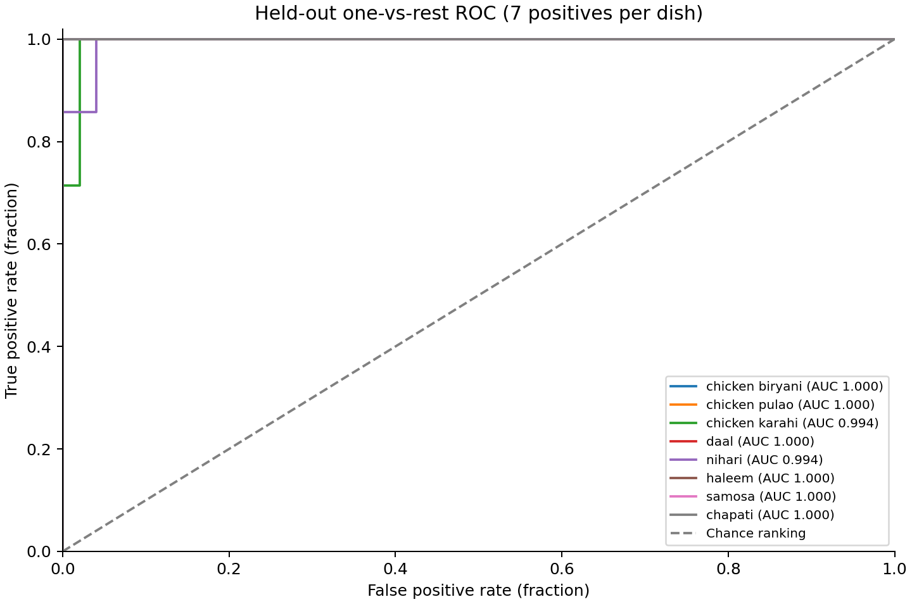
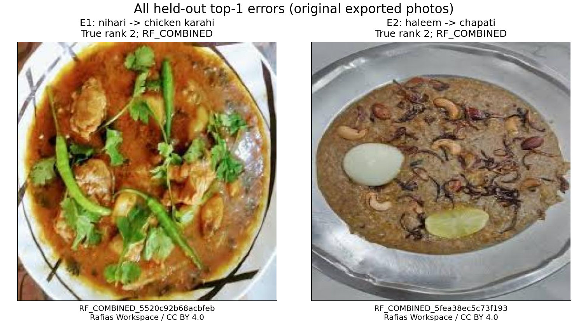

# Macromate: Deliverable 2

Model Architecture and Empirical Evaluation

Macromate recognizes eight Pakistani dish categories from photos using PyTorch and a partially fine-tuned pretrained CLIP ViT-B/32. The 400-photo dataset has 50 photos per dish. The selected model correctly recognizes 54 of 56 held-out photos (96.43%); this small, source-confounded sample does not establish real-world performance.

Evidence consists of training.json (settings, learning history and verification), predictions.csv (every held-out prediction), and evaluation.json (protocol, metrics, reviews and model details). This report recomputes metrics from the CSV and does not run test inference.

## Current implementation

The model implementation is in models/. The models package contains nine Python files, including __init__.py as its package marker. config.py owns settings and evidence-file reading/writing; data.py owns dataset validation, image preprocessing and loaders; clip_classifier.py owns CLIP and checkpoint saving/loading; train.py owns training, epoch selection and checkpoint verification.

evaluate.py runs held-out evaluation, metrics.py implements numerical measurements, infer.py predicts dishes for new photos, and report.py builds this report from saved results. Grouping these responsibilities preserved the architecture, checkpoint format and measured results.

The development workflow is train, evaluate, then report. Training includes checkpoint verification. Standalone verification uses python -m models.train --verify-only with the experiment's --evidence directory; it does not retrain or score held-out photos. Inference needs best.pt and the pinned runs/hub base cache, without reading the evidence files or importing training.

Historical evidence retains the source-file identities and hashes recorded for the original run. The consolidated training and evaluation records retain pilot selection and evaluation-correction provenance. Active model commands do not require the earlier phase-specific files or an archive.

## Phase 3: model architecture

The vision encoder embeds 32-by-32 patches from a 224-by-224 RGB input into 49 patch tokens plus a class token (hidden width 768). Its 12 Transformer blocks use 12 attention heads and a 3072-wide MLP. The class-token output passes through final layer normalization and a 768-to-512 visual projection. The frozen text encoder uses 12 blocks, hidden width 512 and eight attention heads; its projected prompt vectors are computed once and stored in the checkpoint.

CLIP ViT-B/32 compares each photo with eight fixed 'a photo of Pakistani [dish]' text vectors. Only vision blocks 10 and 11, final vision normalization and visual projection are trained. Training uses cross-entropy, AdamW, warmup/cosine decay and gradient clipping. The pinned base revision is 3d74acf9a28c67741b2f4f2ea7635f0aaf6f0268.

For each class c, the logit is exp(logit_scale) times the dot product of the unit-length image and prompt vectors. Categorical cross-entropy compares all eight logits with the integer dish label; there are no class weights or label smoothing. Only 14,570,496 parameters are trainable. AdamW uses separate block and normalization/projection learning rates; biases and normalization parameters receive zero weight decay. Gradients are clipped to norm 1.0; learning rates use 10% warmup followed by cosine decay. Dropout remains at the pretrained value zero.

## Hyperparameter tuning

| Candidate | Block LR | Proj. LR | Batch | Decay | Dropout | Val. correct | Val. loss |
| --- | --- | --- | --- | --- | --- | --- | --- |
| baseline | 1e-05 | 5e-05 | 8 | 0.01 | 0.0 | 58/64 | 0.294529 |
| block_low | 5e-06 | 5e-05 | 8 | 0.01 | 0.0 | 57/64 | 0.307729 |
| block_high | 2e-05 | 5e-05 | 8 | 0.01 | 0.0 | 58/64 | 0.282456 |
| projection_low | 1e-05 | 2e-05 | 8 | 0.01 | 0.0 | 57/64 | 0.302356 |
| batch_16 | 1e-05 | 5e-05 | 16 | 0.01 | 0.0 | 57/64 | 0.344546 |
| no_decay | 1e-05 | 5e-05 | 8 | 0.0 | 0.0 | 58/64 | 0.294530 |

Six exploratory candidates were trained for two epochs each on the same 280 training and 64 validation photos; test photos were excluded. Selection prioritized validation correct count, then loss, then runtime for exact ties. The selected candidate was block_high: 58/64 correct with the lowest tied-count validation loss (0.282456). This favors block LR 2e-5, projection LR 5e-5, batch 8 and decay 0.01. Batch 16 and smaller learning rates did not improve this pilot.

Dropout 0, maximum 20 epochs, patience 5, seed 42, fixed prompts, optimizer and scheduler are design choices, not demonstrated tuning winners. The pilot uses one seed and a short budget; one validation photo changes accuracy by 1.5625 percentage points. The six candidates do not establish a global optimum.

## Phase 4: training and validation

| Setting | Value |
| --- | --- |
| block_lr | 2e-05 |
| projection_lr | 5e-05 |
| batch_size | 8 |
| weight_decay | 0.01 |
| epochs | 20 |
| patience | 5 |
| seed | 42 |
| warmup_fraction | 0.1 |
| gradient_clip | 1.0 |
| betas | [0.9, 0.999] |
| epsilon | 1e-08 |
| dropout | 0.0 |

Fixed stratified, group-aware split: 280 training, 64 validation, 56 test photos. Training updates weights; validation selects the epoch; test images measure the selected model. Whole-image allocation gives 70%/16%/14% (35/8/7 photos per dish). Seed 42 fixes membership; exact/perceptual duplicate groups stay in one partition. The held-out results were not used for tuning.

Completed 11 epochs; selected epoch 6 by validation top-1 count, then lower loss, then earlier epoch. Validation top-1: 61/64; loss 0.215961. Training time: 46.4 seconds.

Checkpoint reconstruction verified 64 validation rows; maximum absolute logit difference 0.0. Original-photo preprocessing and the app-facing prediction were also checked. Verification status: passed.

Recorded training environment: Python 3.12.14, NVIDIA GeForce RTX 3050 Laptop GPU, PyTorch 2.9.0+cu128, precision float32.

## Held-out evaluation

Top-1: 54/56 (96.43%). Top-3: 56/56 (100.00%). Macro F1: 0.9641.

The checkpoint, data hashes and evaluation rules were recorded before inference on 2026-11-09 at 17:08:26 UTC. Evaluation attempts, including failures, are retained; repeat evaluation in the same directory is refused. Figures and metrics reuse saved predictions.

| Dish | Support | Precision | Recall | F1 | ROC-AUC |
| --- | --- | --- | --- | --- | --- |
| chicken biryani | 7 | 1.0000 | 1.0000 | 1.0000 | 1.0000 |
| chicken pulao | 7 | 1.0000 | 1.0000 | 1.0000 | 1.0000 |
| chicken karahi | 7 | 0.8750 | 1.0000 | 0.9333 | 0.9942 |
| daal | 7 | 1.0000 | 1.0000 | 1.0000 | 1.0000 |
| nihari | 7 | 1.0000 | 0.8571 | 0.9231 | 0.9942 |
| haleem | 7 | 1.0000 | 0.8571 | 0.9231 | 1.0000 |
| samosa | 7 | 1.0000 | 1.0000 | 1.0000 | 1.0000 |
| chapati | 7 | 0.8750 | 1.0000 | 0.9333 | 1.0000 |
| Macro | 56 | 0.9688 | 0.9643 | 0.9641 | 0.9985 |
| Weighted | 56 | 0.9688 | 0.9643 | 0.9641 | 0.9985 |

Precision is TP/(TP+FP), recall is TP/(TP+FN), and F1 is their harmonic mean. Macro averages weight dishes equally; weighted averages use class support. ROC-AUC measures one-vs-rest score ranking with tied scores grouped. Scores are uncalibrated. Confusion rows are true labels.

Precision measures incorrect dish suggestions, recall measures missed instances of a dish, and F1 summarizes that tradeoff. Macro averaging gives each dish equal importance and would expose weak classes even if support became imbalanced. Here every class has seven test photos, so macro and support-weighted means coincide. One-vs-rest ROC-AUC checks score ranking across thresholds and complements the single top-1 decision; high AUC does not imply calibrated probabilities, reliable unfamiliar-food rejection, or fairness.

## Error analysis

RF_COMBINED_5520c92b68acbfeb: nihari predicted as chicken karahi; true rank 2. The reddish-brown meat curry, green chilies and coriander plausibly share visual cues with chicken karahi. The curry is visible despite the provider's partly cut plate edge; the square-to-square model resize adds no geometric crop. Recipe and meat type cannot be established from pixels alone. This explanation is a hypothesis; the nihari label remains unchanged. The app must offer correction before choosing the nutrition entry. Source: https://universe.roboflow.com/x9646829-gmail-com/combined-dataset-prqro

RF_COMBINED_5fea38ec5c73f193: haleem predicted as chapati; true rank 2. The broad, flat, roughly circular brown serving on a metal plate could resemble flatbread features. Its textured contents, onion-like strands, nut-like pieces and lime also fit a plated stew. Shape or background are possible cues, not proven causes. The serving is visible and no new crop failure was identified. Keep the source label and let users confirm haleem rather than apply chapati nutrition. Full observations are retained in evaluation.json. Source: https://universe.roboflow.com/x9646829-gmail-com/combined-dataset-prqro

Historical evaluation correction: The first evaluator completed inference but failed during source-metadata joining because raw dish names used underscores while Phase 2 canonical labels used spaces. The fix applies exactly the existing Phase 2 strip/lower/underscore-to-space conversion and validates all metadata labels and source IDs before inference. A regression test covers this raw/canonical join.

## Bias Check and limitations

| Source | Correct / total | Top-1 |
| --- | --- | --- |
| RF_CHAPATI | 9/9 | 100.00% |
| RF_COMBINED | 34/36 | 94.44% |
| RF_NSN | 4/4 | 100.00% |
| RF_SAMOSA | 7/7 | 100.00% |

| Original image size | Correct / total | Top-1 |
| --- | --- | --- |
| 256x256 | 4/4 | 100.00% |
| 432x432 | 34/36 | 94.44% |
| 640x640 | 16/16 | 100.00% |

The test set contains only seven photos per dish. Source, dish and provider image size are confounded, so subgroup differences do not establish causes. The sources largely represent Indian and Bangladeshi appearances; external Pakistani meals remain untested. Second human label review is pending. Demographic data are unavailable. Mixed plates and unfamiliar foods are unsupported.

## Final model and application use

Checkpoint: `runs/phase4/best.pt`

Checkpoint SHA-256: `b9089dffbfdf8c682ed28826be143a647a24a675847ca4291bf6f061c34466e4`

The adapted-weight checkpoint requires the pinned runs/hub base cache. Recognizer(checkpoint, device).predict(photo) returns eight ranked dishes. Ask the user to confirm the dish and enter serving grams before applying the separate per-100-g nutrition reference.

The working prototype includes preparation, training, evaluation, reports and CLI/Python inference. A graphical interface, serving-size workflow, nutrition integration and daily log are future work. The recognizer returns ranked dishes only.

## Contribution Table: verified Git history

The table maps actual commit authors to changed files in the repository history at c64639b01326. It records evidence of authorship, not an independently verified division of effort.

| Student / Git author | Commit evidence | Modules / coding status |
| --- | --- | --- |
| Hassan Mehmood (24L-2559) / Hassan Mehmood | c64639b, 55b7348 | models/clip_classifier.py, train.py, evaluate.py, metrics.py, infer.py. Code commits verified |
| Adnan Zaka (24i-2537) / adnanzaka-dev | 292a618, 232164f | data scripts/clean_data.py, preprocess.py, split_data.py, eda.py. Code commits verified |
| Mohid Israr (24L-2510) / Mohid Israr | 8210194 | data/images/, data/metadata.csv, data/sources.csv. No coding commit found |

No coding commit was found for Mohid Israr (24L-2510). The visible contribution changes source photos and CSV manifests. This does not satisfy the guide's individual coding requirement. Each member must commit their own real implementation work through Git CLI or a desktop client. Existing shared history and author identities are preserved.

Historical commit(s) 406c823 are titled 'Add files via upload'. Their presence is disclosed because the guide prohibits manual GitHub uploads. The historical workflow needs clarification with the instructor; a new CLI commit does not erase a prior policy issue.

## Reproduction and submission assets

Submission checks identified a PNG-encoding dependency: preprocessing with Pillow 11.3.0 changes the compressed bytes of some files even though all 400 decoded RGB arrays are identical. Pillow 13.0.0 recreates every original prepared PNG hash exactly. The submission requirements therefore pin Pillow 13.0.0; the original training environment recorded above remains unchanged in the historical evidence.

Install Python 3.12, the appropriate torch 2.9.0 CPU/CUDA wheel, and requirements.txt. Download the pinned pretrained base model using the README command, restore runs/phase4/best.pt, and verify its SHA-256 above. Run python -m models.infer CHECKPOINT PHOTO --device cpu for a new photo; python -m models.report regenerates this report from saved predictions.

[Download evaluated model weights](https://github.com/MhassaanK68/macromate/releases/download/deliverable-2-weights/macromate-deliverable2-weights.zip)

The 58,351,801-byte checkpoint is distributed in a verified ZIP through GitHub Releases, outside Git history. Its SHA-256 is listed above; the ZIP also includes a manifest, installation instructions and separate checksums.

## Software verification

22 automated tests passed. The complete data pipeline ran twice with 424 identical output files, and all 400 prepared image hashes match the recorded experiment. Dependency checks pass. A separate one-epoch GPU training smoke test completed, saved a checkpoint and independently reproduced all 64 validation rows with zero logit difference. This smoke run did not replace the evaluated model or use held-out inference.

A fresh reconstruction of the original checkpoint on the recorded GPU also reproduced every validation logit exactly. CPU CLI inference returned all eight ranked dishes and matched the recorded single-image GPU output within 1e-4.

Portability limit: full batched CPU replay agrees with the GPU top-1 label on 64/64 validation photos, but its maximum logit difference is 0.324503, exceeding the existing strict cross-device threshold of 1e-4. The strict verifier correctly rejects that numerical replay. Its tolerance has not been relaxed; use the recorded GPU device for exact reproduction. CPU inference remains operational. Original evaluation evidence and weights are unchanged.

The submission checklist records software checks and unresolved collaboration requirements separately from the measured experiment.

## References

[Radford et al. (2021), Learning Transferable Visual Models From Natural Language Supervision](https://arxiv.org/abs/2103.00020)

Architecture settings are taken from the pinned CLIP config.json and the implementation in models/clip_classifier.py. All reported experiment measurements come from the three local evidence files; the pretrained CLIP architecture is adapted rather than introduced as a new model in this project.
